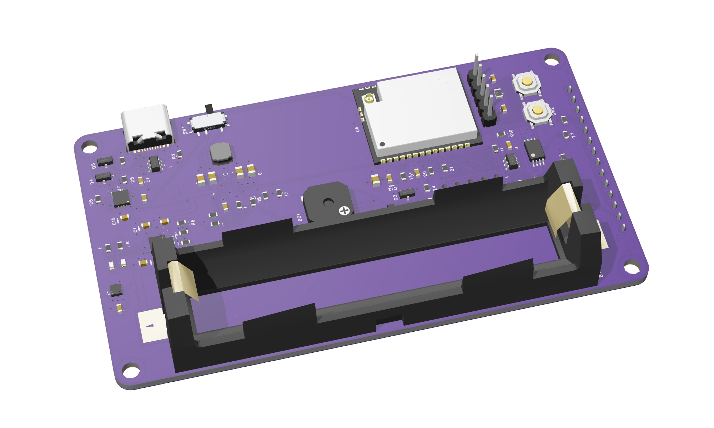
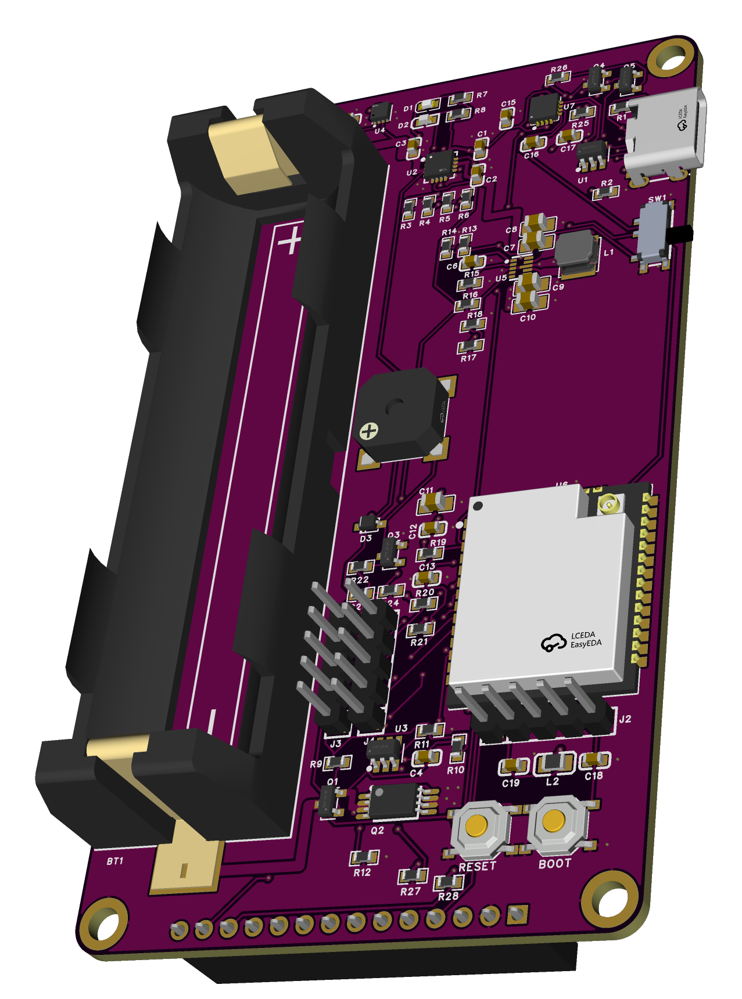
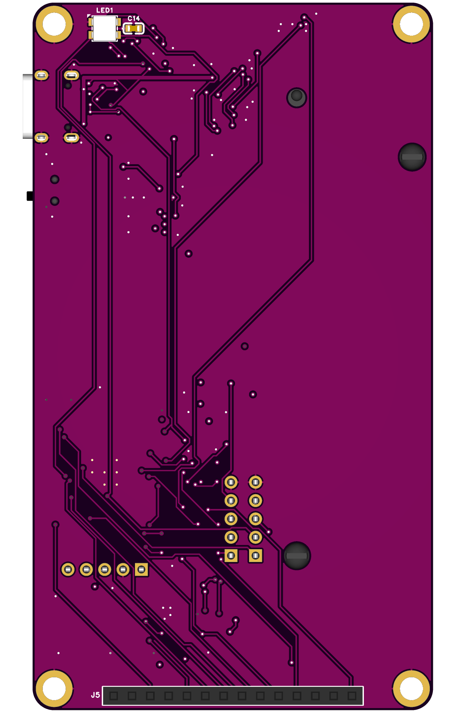

# Marauder C5 Pancake Board

A single board for [ESP32 Marauder](https://github.com/justcallmekoko/ESP32Marauder) on the ESP32-C5. It plugs straight into a 3.5" SPI touch display and runs from one 18650 cell. It replaces the DevKit, charger, boost converter, and fuel gauge modules of the Pancake build, with no wiring between them.



*Render, not a photo. The cell and the display are not shown. Unpopulated J3, J4, R12, R16, R23, R24, R27 and R28 are drawn; U5 has no 3D model.*

## Status

| Part | State |
|---|---|
| PCB | rev1, EasyEDA Pro, DRC 0 errors. Not manufactured |
| Validation | Calculated and checked in CAD only. Nothing measured |

Known risks: [design record](docs/DESIGN-RECORD.md#known-risks-for-the-first-board).

## Features

- **ESP32-C5-WROOM-1U-N8R8:** dual-band 2.4/5 GHz Wi-Fi 6 and Bluetooth LE, 8 MB flash, 8 MB PSRAM, U.FL antenna connector
- **Pancake pinout:** targets the public `MARAUDER_PANCAKE` firmware build with no pin changes
- **One USB-C port:** flashing, console, and charging, through a CH343P bridge with automatic bootloader entry
- **Power:** BQ24074 charger at about 0.45 A, TPS63802 buck-boost for 3.3 V, power switch with a 3.0 V cutoff
- **Cell protection:** DW01A with FS8205A, reverse-polarity MOSFET, MAX17048 fuel gauge
- **Extras:** SK6812MINI-HS RGB LED on GPIO27, buzzer, RESET and BOOT buttons, 1×5 header for an external GPS module

## Specifications

| Item | Value |
|---|---|
| Board | 55.5 × 98 mm, 1.6 mm, 4 layers |
| Mounting | 4 × M3, 49.5 × 92 mm pattern, same as the display |
| Display | 3.5" SPI TFT, 480 × 320, capacitive touch, MSP3526 class |
| Battery | One 18650 Li-ion cell in a solder-on holder, user-swappable |
| Connectors | USB-C, 1×14 display socket, 1×5 GPS header |





## Ordering

Upload [`release/rev1/gerber-rev1.zip`](release/rev1) and send:

```text
5PCS, FR4, 4 LAYERS, 1.6MM, OUTER 1OZ, INNER 0.5OZ, STACKUP JLC04161H-7628, Purple Soldermask, White Legend, ENIG, TENTED VIAS, NO IMPEDANCE CONTROL, order number will be added.
STENCIL: 1PCS, TOP SIDE ONLY.
```

| Item | Value | Why |
|---|---|---|
| Layers | 4 | L2 is solid GND, L3 is the 3V3 pour |
| Copper | 1 oz outer, 0.5 oz inner | Current estimates in the [design record](docs/DESIGN-RECORD.md#step-5-rules-and-stack-up) use these weights |
| Stack-up | JLC04161H-7628 | JLCPCB name. Other fabs can use their standard 1.6 mm 4-layer stack-up, because no net is impedance-controlled |
| Surface finish | ENIG | Flat pads for the 0.5 mm QFN and TDFN parts. Lead-free HASL also works, with more risk of bridges |
| Smallest features | 0.15 mm track, 0.102 mm clearance rule, 0.3 mm via drill, 0.6 mm via pad | Within common 4-layer limits; confirm with the fab |
| Stencil | Top side | `LED1` and `C14` on the display side are soldered by hand |

Before ordering, measure the real holder and display against [`docs/SPEC.md`](docs/SPEC.md#6-mechanics).

## Bill of materials

See [`release/rev1/BOM.md`](release/rev1/BOM.md).

## Repository

| Path | Content |
|---|---|
| [`release/rev1`](release/rev1) | Ordering package: Gerber, BOM, placement |
| [`docs/SPEC.md`](docs/SPEC.md) | Requirements, pinout, mechanics |
| [`docs/DESIGN-RECORD.md`](docs/DESIGN-RECORD.md) | Decisions, calculations, checks, open items |
| [`docs/images`](docs/images) | Renders |

The EasyEDA Pro project `Marauder C5 Pancake` is not stored here.
