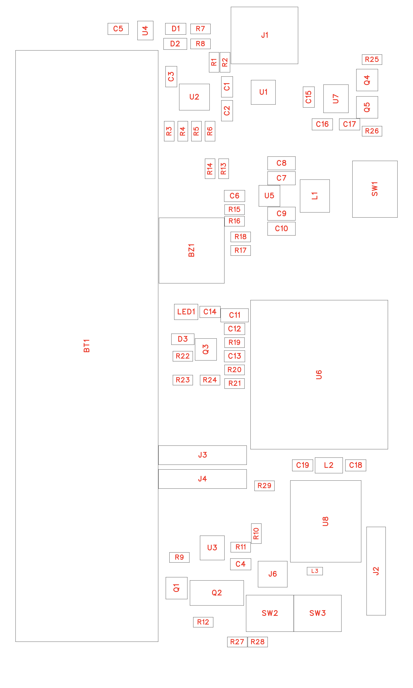

# Placement (step 6)

Status: done. Implemented in PCB1. Coordinates follow `mechanics.md`: view from the electronics side, display socket at the bottom, millimetres.

The image shows body outlines on the top layer. The board outline, holes, and the socket on the display side are not in it.

## Board

| Item | Value |
|---|---|
| Outline | 55.50 × 98.00 mm, 3.0 mm corner radius |
| Holes | 4 × Ø3.2 mm for M3, plated, Ø5.0 mm pad on GND, at (3, 3), (52.5, 3), (3, 95), (52.5, 95) |

The corner radius is concentric with the holes.

## Block floorplan

| Block | Area, mm | Parts | Reason |
|---|---|---|---|
| Battery | X 0–21, Y 6–92 | BT1 | + tab at the top, − tab at the bottom |
| USB-C | X 49–56, Y 79–88 | J1, U1, R1, R2 | Right edge, beside SW1 |
| Charger | X 23–33, Y 79–91 | U2, charger passives | Beside the + tab |
| Status LEDs | X 23–30, Y 92–96 | D1, D2, R7, R8 | Top edge |
| Fuel gauge | X 15–22, Y 93–98 | U4, C5 | At the + tab for a Kelvin connection |
| USB-UART | X 34–50, Y 86–96 | U7, Q4, Q5 | Beside USB-C |
| DC-DC | X 29–46, Y 62–78 | U5, L1, C6–C10, R13–R18 | Between the cell path and the module |
| Power switch | X 50–56, Y 68–76 | SW1 | On the right edge, lever outward |
| MCU | X 31–55, Y 23–45 | U6, C11–C13, R19–R21 | Close to the socket; Y 47–60 stays free for routing |
| Indicators | X 22–31, Y 31–59 | BZ1, LED1, Q3, D3 | Beside the module |
| Debug headers | X 21–34, Y 22–29 | J3, J4 | Unpopulated |
| External GPS | X 39–52, Y 14–21 | J2, L2, C18, C19 | Farthest from the DC-DC inductor |
| Cell protection | X 22–37, Y 11–23 | Q1, Q2, U3, R9–R11, C4 | At the − tab |
| Buttons | X 34–48, Y 6–14 | SW2, SW3 | Bottom edge |
| Display socket | Y 2, display side | J5 | Fixed by the display |
| RGB LED | (45.5, 94.4), display side | LED1, C14 | Side window in the case |

## Socket check

J5 sits on the bottom layer. Read back from EasyEDA: pin 1 is at X = 44.26 and pin 14 is at X = 11.24, Y = 2.00, which matches `mechanics.md`.

## DC-DC layout

| Item | Position |
|---|---|
| U5 | (38.0, 71.0) |
| C7, C8 (input) | VSYS pad 1.6 mm from pin 10 |
| C9, C10 (output) | 3V3 pad 1.6 mm from pin 6 |
| L1 | Right of U5, pad 1 above pin L1 and pad 2 below pin L2, so the nets do not cross |

The capacitor ground pads reach the IC ground through L2. This is an estimate of a compact loop, and it has no inductance budget, because no simulation ran.

## Parts placed outside their group

| Part | Why |
|---|---|
| U4, C5 | At the + tab, far from the battery block's − end, for sensing |
| R10, C4 | Near U3, which is at the − tab, so VDD runs from the + tab along the board as a low-current trace |
| C11, C12 | At module pin 2 |

## Routability

| Metric | Value | Evidence |
|---|---|---|
| Ratsnest length, GND excluded | About 1830 mm before routing | Script, minimum spanning tree per net |
| Ratsnest crossings | About 340 before routing | Script, an upper estimate |
| Most congested | X 30–40, Y 10–40 | Script, 10 mm grid |
| Overlaps | None, by part bounding boxes | Script |
| Beyond the board edge | J1 by 1.5 mm, SW1 by 1.0 mm, intended | Script |

The congested areas are where display and I2C lines leave the left module pins for the socket. Lines from the right module pins must go around the module or pass under it on L4, so the display nets take L4 for most of their length.

## Trade-offs left open

1. **Module rotation.** Turning U6 by 90° could shorten the display nets, but it takes the width of the electronics zone. Not evaluated.
2. **Buttons.** SW2 and SW3 are near the bottom edge on the rear. Top-pressed buttons need a push rod or an opening in the case.
3. **Height.** All parts sit on the rear, next to the holder, and are lower than the cell. Holder height is still unmeasured.
