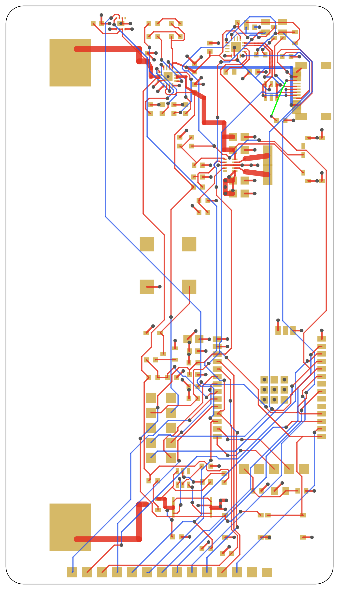

# Routing (step 7)

Status: done without per-block review, because the reviewer waived the remaining gates on 2026-11-06 and asked the work to continue unattended.

Mode: **C, hybrid**. Power and critical nets were routed by script. Signals were routed by the EasyEDA autorouter on L1 and L4, with those nets kept in place. Some nets were ripped up and rerouted when they conflicted with USB.

Red is L1, blue is L4, green is L3, gold is pads, dark dots are vias. Pours are not drawn. Per-layer views: [top](images/routing-top.png), [bottom](images/routing-bottom.png).

## Copper

| Layer | Content |
|---|---|
| L1 | Parts, signals, cell path, DC-DC, GND pour |
| L2 | Solid GND pour |
| L3 | 3V3 pour, plus USB_CC2 as a short track |
| L4 | Signals, VBUS, GND pour |

Pours are inset 0.3 mm from the board edge.

## Critical nets

| Net | Route |
|---|---|
| BAT | L1, 1.0 mm from the + tab to C3, 0.8 mm, then 0.45 mm into U2 |
| VSYS | L1, 0.4 mm for about 4 mm near U2, then 0.8 mm to C7, C8 |
| 3V3 | L1 0.8 mm at C9, C10, then 3 vias to the L3 pour |
| CELL_N | L1, 1.0 mm from the − tab to Q1 |
| B_N | L1, 0.6 mm from Q1 to Q2 |
| FS8205A source to GND | L1 0.6 mm, 3 vias to L2 and L4 |
| DCDC_L1, DCDC_L2 | L1, 0.25 mm neck at the IC pins, then 0.9 mm to L1 |
| AGND | Short stub and its own via to L2 |
| VBUS | L4, 0.5 mm from USB-C to the charger |
| USB D+/D− | J1 pins joined with vias; about 22–25 mm to U7, no impedance control, no matched pair |

## Exceptions

| Item | Reason | Effect |
|---|---|---|
| POWER_2A minimum set to 0.2 mm | Low-current branches, such as BAT to R9, R10, R23, U4 | Main paths checked by hand in `verification.md` |
| VSYS 0.4 mm near U2 | Autorouted CHG_ILIM, CHG_STAT, CHG_TMR nearby | About 1.2 A peak, short |
| USB pair not defined in the end | Stayed flagged as a pair error after hand routing; USB full speed is forgiving | Check enumeration at bring-up |
| USB_CC2 on L3 | No route on L1 or L4 | Small slit in the 3V3 pour |
| Vias in the module ground pad | Connect the pad sections to L2 | Tented under the module |
